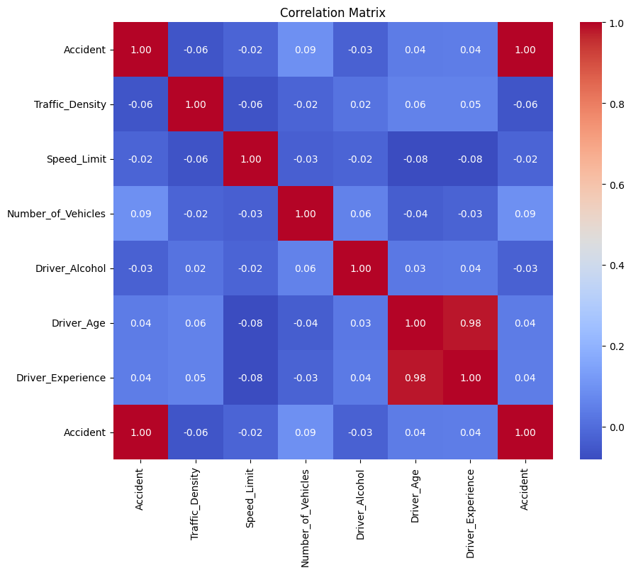
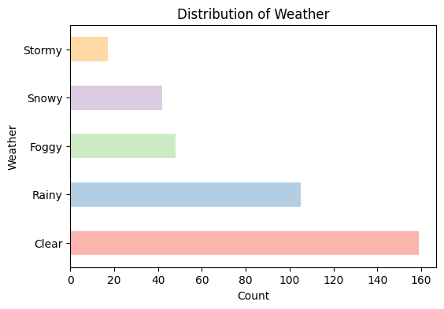
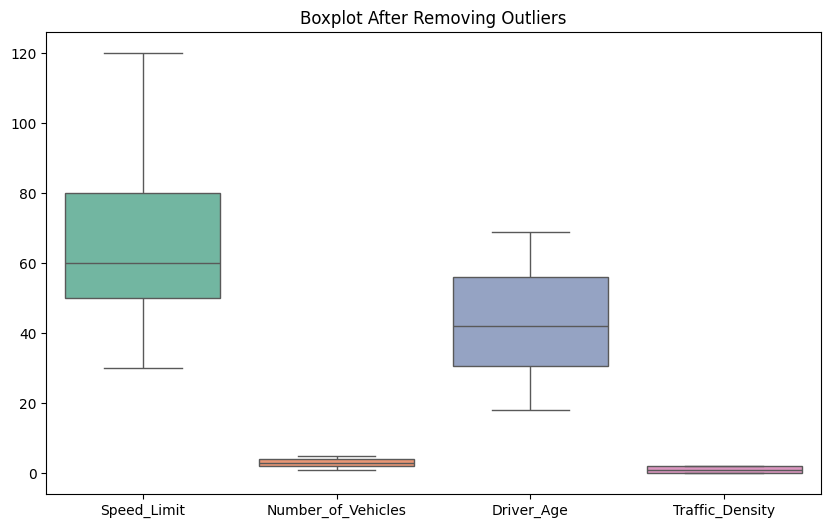
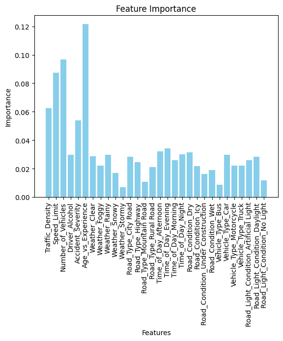

# Traffic Accident Analysis & Prediction

This project explores which **road, weather, driver and traffic conditions** are linked to traffic accidents, and builds a baseline model to predict whether an accident will happen.

<p align="center"></p>

## Dataset

[Traffic Accident Prediction](https://www.kaggle.com/datasets/denkuznetz/traffic-accident-prediction) from Kaggle: 840 records and 14 features.

| Type | Features |
|---|---|
| Environment | Weather, Road Type, Road Condition, Road Light Condition, Time of Day |
| Traffic | Traffic Density, Speed Limit, Number of Vehicles |
| Driver | Driver Age, Driver Experience, Driver Alcohol |
| Vehicle | Vehicle Type |
| Targets | Accident Severity, **Accident (0/1)** |

## Workflow

1. **Cleaning:** Removed duplicate rows and missing values. Removed outliers with the IQR method.
2. **Exploratory analysis:**
   - Distribution plots for every feature
   - Boxplots
   - Pair plots
   - Correlation heatmap
3. **Feature engineering:**
   - Created an `Age_vs_Experience` feature
   - One-hot encoding for unordered categories
   - Label encoding for ordered ones
4. **Modeling:** Random Forest classifier, evaluated with a classification report, a confusion matrix and feature importance.

<p align="center">
  
  
</p>

## Results

The baseline Random Forest reached **69% accuracy**. It recognizes the majority "no accident" class well (recall 0.94), but it misses most actual accidents (recall 0.10). The data is imbalanced, and after cleaning only a few hundred rows remain.

<p align="center"></p>

**Next steps:**

- Handle the class imbalance with class weights or SMOTE.
- Optimize for recall on the accident class.
- Tune the model's hyperparameters.

## Running it

```bash
pip install -r requirements.txt
jupyter notebook traffic_accident_analysis.ipynb
```

The dataset is in `data/Traffic_Accident.csv`. Update the `read_csv` path in the first cell if you're not running it on Colab.

> **Note:** The saved outputs in the notebook were produced on a copy of the dataset with extra duplicate rows and missing values added on purpose to practice cleaning (843 rows). The file in `data/` is the original Kaggle version (840 rows), so re-running the notebook gives slightly different numbers.

## Tech stack

Python · pandas · Matplotlib · Seaborn · scikit-learn
